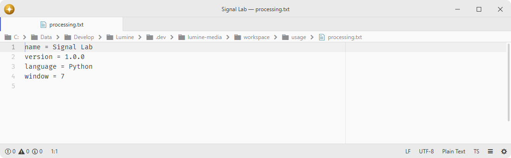
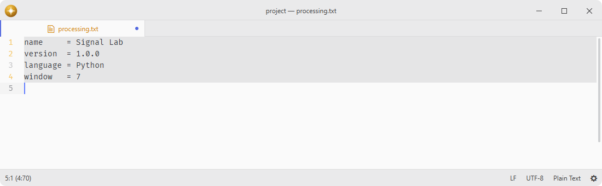

# regex-aligner

Align text using regular expressions or multiple cursors.

Enter a pattern and text is aligned at matching positions.

Alignment prepares changes against immutable text snapshots, yields during long work, and publishes all edits together as one undo step. Literal separators, including escaped literals and simple capture wrappers, support arbitrarily long rows without constructing a whole-row string. General regular expressions run in a cancellable worker with an 8 Mi UTF-16 unit input limit per row and a one-second execution budget per batch; unsupported rows produce an explicit error before any edit. Separator expressions themselves are limited to 65,536 UTF-16 units. Captures do not create extra columns, and zero-width separators retain native per-line matching semantics.

Column widths use a bounded memory cache that spills metadata to an operation-owned temporary file when needed; the file is removed after completion, cancellation or failure. No columns are silently dropped. Padding shares immutable text blocks, original line endings are preserved, and edits change only the necessary whitespace gaps so markers inside retained cell text keep their geometry. Closing the dialog or changing its source or selections cancels pending preparation.

## Features

- **Regex alignment**: align text at regex-matched separators.
- **Cursor alignment**: align multiple cursors to the rightmost one.

## Installation

To install `regex-aligner` search for it in the Install pane of the Lumine settings, or run the command `lumine --install lumine-code/regex-aligner`.

## Commands

Commands available in `lumine-text-editor:not([mini]):not([readonly])`:

- `regex-aligner:toggle`: open dialog to get a regex expression as separator,
- `regex-aligner:simple`: align multiple cursors to the rightmost one.

Commands act on the editor that invoked them. The application menu and command palette preserve the editor focused before they opened, and the regex dialog keeps that editor as its target until confirmation. `regex-aligner:toggle` also closes the dialog from its own `.regex-dialog` scope.

## Contributing

Got ideas to make this package better, found a bug, or want to help add new features? Just drop your thoughts on GitHub. Any feedback is welcome!
